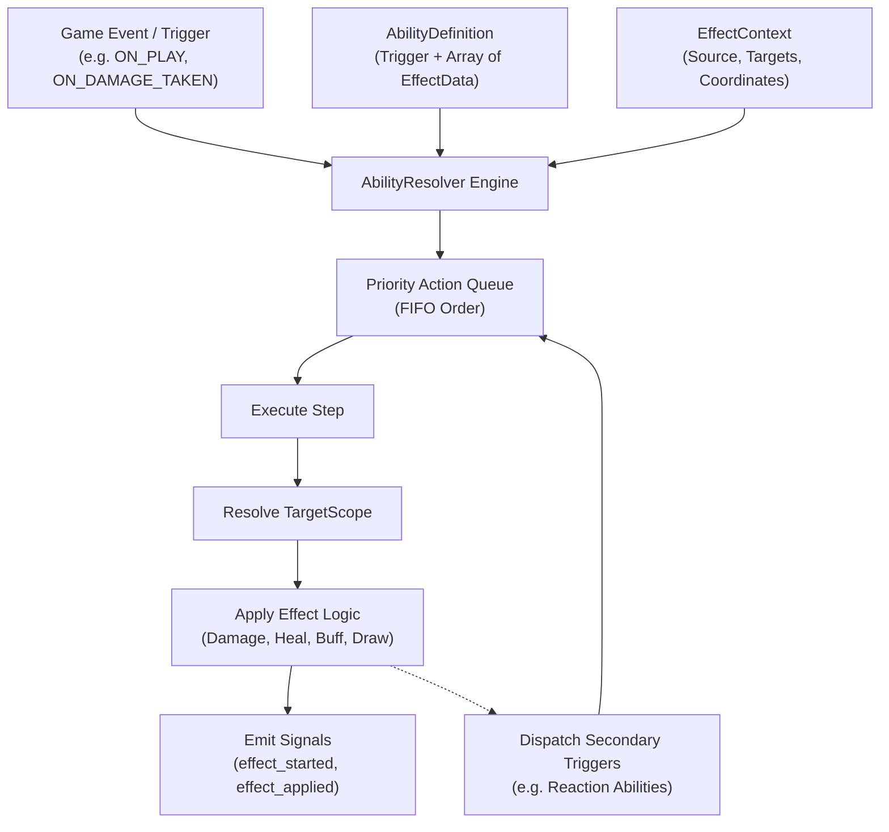

# Universal Ability & Effect Engine (Standalone Godot 4 Module)

A completely decoupled, data-driven trigger and effect resolver system for Godot 4.

Designed following the **Systems-First** architecture: zero game-specific coupling, self-contained testbeds, deterministic action queues, priority-based resolution, and extraction-ready for any TCG, turn-based battler, RPG, or board game.

---

## Features

- **Generic Effect Data Model (`EffectData.gd`)**:
  - Discrete action definitions: `DAMAGE`, `HEAL`, `BUFF_STAT`, `GAIN_RESOURCE`, `DRAW_CARD`, `DISCARD_CARD`, `DESTROY`, `SWAP_STATS`, `CUSTOM`.
  - Scopes: `SELF`, `TARGET_SINGLE`, `ALL_FRIENDLY`, `ALL_ENEMY`, `ADJACENT_FRIENDLY`, `OPPOSING_LANE`, `RANDOM_ENEMY`, `ALL_UNITS`.
  - Static factory constructors (`create_damage`, `create_heal`, `create_buff`, `create_draw`, `create_resource_gain`).
- **Flexible Execution Context (`EffectContext.gd`)**:
  - Encapsulates source entity, source coordinate `(side, lane)`, resolved targets list, triggering event name, and arbitrary runtime variables (e.g. crit multipliers).
- **Composite Ability Container (`AbilityDefinition.gd`)**:
  - Binds a trigger event (`ON_PLAY`, `ON_SUMMON`, `ON_DEATH`, `ON_TURN_START`, `ON_TURN_END`, `ON_ATTACK`, `ON_DAMAGE_TAKEN`, `ON_ACTIVATE`) to an ordered sequence of `EffectData` actions.
- **Queue & Action Resolver (`AbilityResolver.gd`)**:
  - Deterministic FIFO execution queue with priority support.
  - Asynchronous animated step-by-step resolution (`process_queue_async(step_delay)`) and instantaneous synchronous resolution (`resolve_all_sync()`).
  - Native target mutation support for Godot Nodes, Objects (method calls `take_damage`, `heal`, `apply_buff`), and standard Dictionaries (`def`, `hp`, `atk`).
  - Trigger listener registration for reactive abilities (e.g. Deathrattles, Thorns, Counterattacks).
- **Standalone Interactive Testbed (`testbed_abilities.tscn`)**:
  - Isolated runnable GUI scene featuring 4 mock combatants, 6 castable spells/abilities, reactive Thorns counters, a step-by-step queue visualizer, and a real-time event log.
- **Automated Regression Test Suite (`test_ability_engine.gd`)**:
  - 100% headless test coverage running locally and on GitHub Actions CI.

---

## Architecture Diagram



---

## Integration Guide

### 1. Defining an Ability

```gdscript
const EffectData = preload("res://src/systems/ability_engine/EffectData.gd")
const AbilityDefinition = preload("res://src/systems/ability_engine/AbilityDefinition.gd")

# Create a spell that deals 5 damage to target and heals caster for 3
var fireball = AbilityDefinition.create(
    "spell_fireball",
    "Fireball",
    "ON_PLAY",
    [
        EffectData.create_damage(5, EffectData.TargetScope.TARGET_SINGLE),
        EffectData.create_heal(3, EffectData.TargetScope.SELF)
    ]
)
```

### 2. Enqueuing and Resolving

```gdscript
const EffectContext = preload("res://src/systems/ability_engine/EffectContext.gd")
const AbilityResolver = preload("res://src/systems/ability_engine/AbilityResolver.gd")

@onready var resolver: AbilityResolver = $AbilityResolver

func cast_spell(caster_entity, target_entity) -> void:
    var context = EffectContext.create(caster_entity, 0, 0, [target_entity])
    resolver.enqueue_ability(fireball, context)
    resolver.process_queue_async(0.2) # Animate with 0.2s delay between effects
```

### 3. Setting Up a Reactive Ability (e.g. Thorns)

```gdscript
var thorns = AbilityDefinition.create(
    "passive_thorns",
    "Thorns",
    "ON_DAMAGE_TAKEN",
    [EffectData.create_damage(2, EffectData.TargetScope.TARGET_SINGLE)]
)

# Register defender to listen for damage reaction
resolver.register_trigger_listener(thorns, defender_unit)

# When defender takes damage:
resolver.dispatch_trigger("ON_DAMAGE_TAKEN", defender_unit, reaction_context)
```

---

## API Reference

### `AbilityResolver`
| Method | Description |
| :--- | :--- |
| `enqueue_ability(ability, context, priority = 0)` | Appends all effects in an ability to the queue. |
| `enqueue_effect(effect, context, priority = 0)` | Appends a single effect into the queue. |
| `resolve_all_sync()` | Instantly resolves all queued effects without delay. |
| `process_queue_async(step_delay = -1.0)` | Asynchronously steps through queue with optional delay. |
| `register_trigger_listener(ability, entity, side)` | Registers a reactive trigger listener. |
| `unregister_entity_listeners(entity)` | Removes all listeners registered to an entity. |
| `dispatch_trigger(trigger_name, source, context)` | Fires an event trigger and enqueues matching listeners. |
| `get_queue_size() -> int` | Returns the count of pending effects in queue. |
| `clear_queue()` | Clears all pending effects in queue. |

---

## Standalone Testbed

Launch the isolated testbed scene:

```bash
godot ability_engine/testbed_abilities.tscn
```
