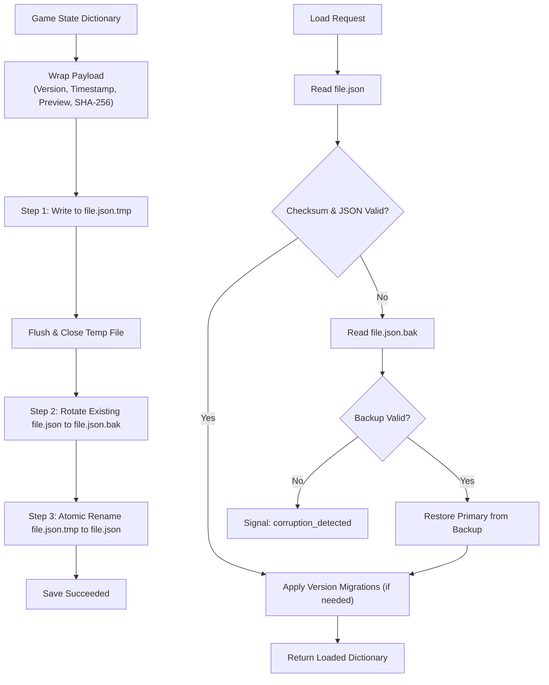

# Universal Save Vault & State Serializer (Standalone Godot 4 Module)

A completely decoupled, enterprise-grade JSON save system with atomic file writes, SHA-256 integrity verification, rolling backups, and schema version migrations for Godot 4.

Designed following the **Systems-First** architecture: zero game-specific coupling, self-contained testbeds, corruption recovery fallbacks, and extraction-ready for any Godot project.

---

## Features

- **Atomic File Writes (`.tmp` ➔ Rename)**:
  - Eliminates zero-byte corruptions caused by game crashes or OS shutdowns mid-write. Data is flushed to a temporary file first, then atomically swapped into place.
- **Rolling Backups (`.bak`)**:
  - Automatically maintains the previous session's healthy save before overwriting.
- **SHA-256 Checksum Verification**:
  - Computes and embeds a cryptographic hash of the string payload. Catches corrupted bytes, file truncations, and manual JSON edit errors before loading.
- **Automatic Corruption Fallback**:
  - If the primary save is unreadable or fails checksum verification, the vault automatically falls back to `.bak`, recovers the state, and restores the primary file.
- **Automated Version Migration Pipeline**:
  - Tracks schema versions (`_vault_version`).
  - Allows registering step-by-step upgrade callables (`register_migration(target_version, callable)`), seamlessly migrating older save files to new schemas.
- **Multi-Slot Management**:
  - Query slot metadata (`get_slot_meta`), list existing slots (`list_slots`), delete slots, and check existence without reading full payloads into memory.
- **Standalone Interactive Testbed (`testbed_save.tscn`)**:
  - Isolated runnable GUI scene featuring real-time JSON editing, slot switching, chaos testing (intentionally corrupting primary saves to test automatic `.bak` recovery), and version migration testing.
- **Automated Regression Test Suite (`test_save_vault.gd`)**:
  - 100% headless test coverage running locally and on GitHub Actions CI.

---

## Architecture Diagram: Atomic Write & Recovery Flow



---

## 📋 Universal Save Schema Standard (v1)

While `SaveVault` supports any dictionary payload, consuming games should conform to this canonical top-level schema standard:

```json
{
  "_vault_version": 1,
  "_vault_timestamp": "2026-11-02T22:00:00",
  "meta": {
    "save_version": 1,
    "playtime_seconds": 1240,
    "display_name": "Player 1"
  },
  "player": {
    "level": 14,
    "currencies": { "gold": 3200, "gems": 15 },
    "active_hero": "Hero_01"
  },
  "inventory": {
    "cards": [ { "id": "c_01", "count": 2 } ],
    "deck_presets": [ { "name": "Main Deck", "cards": ["c_01"] } ]
  },
  "campaign": {
    "completed_stages": { "stage_01": 3 },
    "current_stage": "stage_02"
  },
  "settings": {
    "bgm_volume": 0.8,
    "sfx_volume": 1.0
  }
}
```

---

## Integration Guide

### 1. Basic Save & Load

```gdscript
# Example path when included as a submodule in a host project (e.g. res://src/systems/ or res://addons/):
const SaveVault = preload("res://src/systems/save_vault/SaveVault.gd")
# Or if placed directly at your project root:
# const SaveVault = preload("res://save_vault/SaveVault.gd")

var vault: SaveVault

func _ready() -> void:
    vault = SaveVault.new("user://saves/", 1)
    add_child(vault)

func save_game(slot_name: String) -> void:
    var player_data = {
        "player_name": "Finn",
        "level": 10,
        "inventory": ["Demon Sword", "Pie"]
    }
    var preview = {"player_name": "Finn", "level": 10}
    vault.save_slot(slot_name, player_data, preview)

func load_game(slot_name: String) -> void:
    var data = vault.load_slot(slot_name)
    if not data.is_empty():
        print("Loaded player: ", data["player_name"])
```

### 2. Version Migrations

```gdscript
# Register upgrade from Version 1 to Version 2
vault.current_version = 2
vault.register_migration(2, func(old_data: Dictionary) -> Dictionary:
    old_data["gems"] = 100 # Add new field introduced in v2
    return old_data
)

# When loading a v1 save file, it automatically executes the migration
var upgraded_data = vault.load_slot("slot_1")
```

---

## API Reference

### `SaveVault`
| Method | Description |
| :--- | :--- |
| `save_slot(slot_id, data, preview_meta = {}) -> bool` | Atomically writes data to slot with checksum and backup rotation. |
| `load_slot(slot_id) -> Dictionary` | Loads slot with checksum verification and automatic `.bak` recovery. |
| `get_slot_meta(slot_id) -> Dictionary` | Reads version, timestamp, and preview metadata without loading payload. |
| `list_slots() -> Array[Dictionary]` | Returns metadata for all existing save slots. |
| `slot_exists(slot_id) -> bool` | Returns `true` if primary save or backup exists. |
| `delete_slot(slot_id) -> bool` | Removes primary, `.tmp`, and `.bak` files for slot. |
| `register_migration(target_version, callable)` | Registers an upgrade function for version migration. |

---

## Standalone Testbed

Launch the isolated testbed scene:

```bash
godot save_vault/testbed_save.tscn
```
